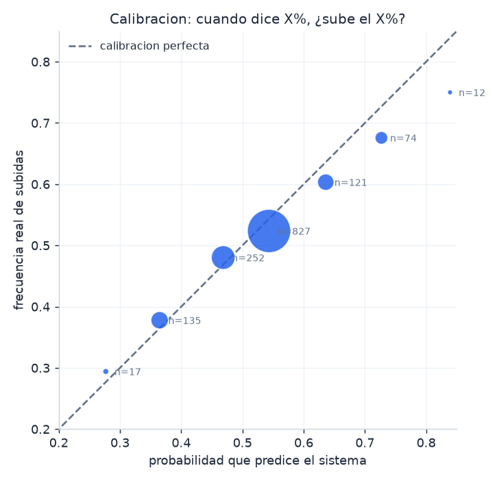

# Bot que aprende patrones de gráficos de trading

Sistema que **aprende jugando** a reconocer tramos de gráfico y predecir hacia
dónde irá el precio en las próximas barras. Es la misma idea que un bot que juega
al Worldle y aprende de sus errores, llevada al análisis técnico: en cada
"partida" se le enseña un tramo de gráfico que no ha visto, dice si le suena la
forma y qué cree que va a pasar, y luego se le revela lo que pasó de verdad para
que aprenda.

> **Aviso.** Esto es un trabajo de estudio sobre aprendizaje automático aplicado
> a series financieras. El modelo es deliberadamente simple e interpretable. **No
> es una recomendación de inversión ni una estrategia lista para operar con dinero
> real.** El valor del proyecto está en *medir con honestidad* cuánto se puede (y
> cuánto no se puede) predecir, no en prometer aciertos.

---

## Qué tiene en cuenta

Para cada tramo de gráfico, el sistema construye un "caso" con:

- **La forma del precio** en la temporalidad diaria (últimas 40 barras),
  normalizada a media 0 y desviación 1 para que dos tramos con el mismo dibujo se
  parezcan aunque estén a distinto precio y con distinta volatilidad.
- **La forma en temporalidades superiores**: semanal y mensual (solo con velas ya
  cerradas — ver más abajo *por qué esto importa tanto*).
- **La forma del volumen** en la misma ventana.
- **Indicadores técnicos**: RSI (14 y 2), MACD, ADX y ±DI, %B de Bollinger,
  medias y pendientes, distancia a máximos/mínimos de 252 sesiones, retornos a
  varios plazos.
- **Volumen**: z-score, tendencia (media corta frente a larga), pendiente del OBV.
- **Volatilidad**: ATR%, volatilidad realizada, ratio de volatilidad corto/largo,
  tamaño de las velas, gaps.
- **Contexto de mercado**: régimen del índice (por encima/debajo de la SMA200,
  drawdown, percentil de volatilidad), **sector** del valor y **fuerza relativa**
  frente al índice y al sector.
- **Noticias**: sentimiento de los titulares con decaimiento temporal, número de
  titulares y cuánto se contradicen entre sí.

Y guarda **lo que pasó después**: retorno a *h* barras, dirección, y el recorrido
máximo a favor y en contra (en múltiplos de ATR).

## Cómo predice y cómo aprende

1. **Memoria de casos.** Para un tramo nuevo busca los *k* casos más parecidos del
   pasado y promedia sus desenlaces, ponderando por parecido. De ahí salen la
   probabilidad de subida, el retorno esperado y el **cono** de escenarios (p10–p90).
2. **Se abstiene cuando no reconoce la forma.** Si los vecinos más cercanos están
   lejos o no se ponen de acuerdo, la confianza baja y el sistema dice "me
   abstengo" en lugar de inventar una predicción.
3. **Aprende de sus errores de dos formas**, cuando se le revela el resultado real:
   - **Reajusta el peso de cada grupo de features** (forma, momento, volumen,
     noticias…) con un esquema tipo *Hedge*: el grupo que habría acertado gana
     peso, el que falló lo pierde. Es la versión medible de "ahora me fío más del
     volumen": se mide, no se decide a dedo.
   - **Recalibra sus probabilidades** contra la frecuencia real observada, para no
     decir "70%" cuando la realidad es 55%.

## Por qué los resultados son creíbles (lo más importante del trabajo)

Predecir mercados es difícil de verdad. Cualquiera puede sacar un 80% de acierto
si, sin querer, deja que el modelo vea el futuro. Este proyecto está construido
para que eso **no pueda pasar**, y los tests lo vigilan:

- **Purga temporal:** un caso solo puede ser "vecino" si su resultado ya se conocía
  antes de la fecha de la consulta.
- **Velas superiores solo si están cerradas:** a mitad de semana, la vela semanal
  en curso contiene el viernes, que aún no ha pasado. Usarla sería ver el futuro.
- **Noticias estrictamente anteriores** a la barra evaluada.
- **Evaluación walk-forward:** se entrena con el pasado y se predice el futuro,
  cinco veces, avanzando en el tiempo. Nunca una sola división train/test.
- **Observaciones no solapadas:** dos ventanas consecutivas comparten 39 de 40
  barras. Contarlas como independientes infla la significación, así que se toma
  una cada *h* barras por valor.
- **Baselines que hay que batir:** "siempre sube", aleatorio y momento puro. Si el
  sistema no los supera, no sirve — y eso también sería un resultado válido.
- **Backtest con costes** (comisión + horquilla). Una señal que no sobrevive a los
  costes no es una señal.

## Resultados (mercado sintético de prueba, walk-forward de 5 pliegues)

Medido sobre 1 440 predicciones no solapadas, 12 valores, 2013–2021:

| Métrica | Memoria de casos | Baseline | Log. | GBM |
|---|---|---|---|---|
| Acierto direccional | **55.1%** (IC95 52.5–57.6) | 51.7% | 52.9% | 52.9% |
| AUC | **0.570** | 0.500 | 0.523 | 0.543 |
| Brier | **0.245** | — | 0.258 | 0.248 |
| Acierto en el cuartil de más confianza | **63.6%** | — | — | — |
| IC de Spearman (retorno esperado vs real) | **+0.157** (p<0.0001) | — | — | — |

Backtest con 10 pb de coste por lado: **Sharpe ≈ 1.0**, 61.8% de acierto en las
490 operaciones que sí tomó (se abstiene el 43% de las veces).

Lectura honesta: **~55% de acierto direccional** en un problema donde el azar es
50%. Es una ventaja pequeña pero real, estadísticamente significativa, que bate a
los baselines y a los modelos supervisados de contraste, y — lo más útil — **la
confianza discrimina**: cuando el sistema dice que está seguro, acierta bastante
más. Esto es exactamente lo que cabe esperar de un problema difícil bien medido;
desconfía de cualquier trabajo que te prometa mucho más.

### Figuras

| | |
|---|---|
|  |  |
|  |  |

En la evolución de pesos se ve el aprendizaje en acción: en el pliegue que cubre
el desplome de 2020, el peso de los **osciladores** salta de 0.08 a 0.46 — el
sistema se da cuenta solo de que en pánico manda la sobreventa, no la tendencia.

## Uso

```bash
pip install -r requirements.txt

# Pasada rápida de ejemplo (mercado sintético, sin conexión)
python bot.py demo

# Jugar partidas y ver cómo aprende de cada una
python bot.py simular --rondas 60

# Evaluación completa: walk-forward, baselines, backtest, calibración
python bot.py evaluar --pliegues 5 --comparar

# Predecir el próximo tramo de un valor
python bot.py predecir --ticker SYN03
```

### Con tus propios datos

Exporta un CSV de OHLCV por valor (desde TradingView, Investing, etc.) a una
carpeta — acepta los nombres de columna habituales en español e inglés — y añade
`_meta.csv` (ticker, sector, nombre) e `_INDICE.csv` si los tienes:

```bash
python bot.py evaluar  --fuente csv --carpeta datos/mi_cartera --comparar
python bot.py predecir --fuente csv --carpeta datos/mi_cartera --ticker AAPL
```

Para noticias reales, un CSV con columnas `fecha, ticker, titular`
(`--noticias csv --noticias-csv datos/noticias.csv`). **Importante:** deben ser
titulares con fecha real (*point-in-time*); etiquetar barras viejas con titulares
descargados hoy mete información del futuro e invalida los resultados.

### Con Yahoo Finance

```bash
python bot.py evaluar --fuente yahoo --tickers AAPL,MSFT,NVDA,JPM,XOM
```

(Requiere salida a internet a Yahoo; en algunos entornos Yahoo responde 429 y hay
que usar CSV o el mercado sintético.)

## Estructura

```
bot.py                   CLI: demo / simular / evaluar / predecir
patrones/
  indicadores.py         RSI, MACD, ADX, Bollinger, ATR, OBV... (sin mirar al futuro)
  datos.py               CSV, yfinance y generador de mercado sintético con patrones plantados
  contexto.py            régimen de mercado, sector, fuerza relativa
  noticias.py            sentimiento de titulares con decaimiento temporal
  ventanas.py            construcción de casos (forma + indicadores + contexto + resultado)
  memoria.py             memoria de casos: predice por vecinos y aprende de sus errores
  modelos.py             modelos supervisados de contraste (logística, GBM)
  evaluacion.py          walk-forward, baselines, backtest, calibración, métricas
  simulador.py           bucle de "partidas" que aprende cronológicamente
  pipeline.py            monta el universo y el banco de casos desde la CLI
tests/                   21 tests; el grueso vigila que no se cuele información del futuro
figuras/                 gráficas del informe
```

## Sobre el mercado sintético

El generador (`patrones/datos.py`) no es un juguete cualquiera: tiene factor de
mercado con regímenes (alcista tranquilo / bajista volátil), factores de sector,
agrupamiento de volatilidad, y **planta figuras clásicas** (doble techo, H-C-H,
bandera, taza con asa, triángulo descendente, cuña…) que se cumplen solo con la
frecuencia que fija su catálogo — ninguna acierta siempre. Sirve para lo que un
dato real no permite: como *sabemos* qué patrones hay y qué ventaja tienen,
podemos comprobar que la tubería los encuentra en vez de confiar en la suerte. Es
el equivalente a un test de integración para un sistema de predicción.

---

_Proyecto académico. Modelo estadístico simple con fines educativos; no constituye
asesoramiento financiero._
