# Bot que aprende patrones de gráficos de trading

Sistema que **aprende jugando** a reconocer tramos de gráfico y predecir hacia
dónde irá el precio en las próximas barras. Es la misma idea que un bot que juega
al Worldle y aprende de sus errores, llevada al análisis técnico: en cada
"partida" se le enseña un tramo de gráfico que no ha visto, dice si le suena la
forma y qué cree que va a pasar, y luego se le revela lo que pasó de verdad para
que aprenda.

> **Aviso.** Esto es un trabajo de estudio sobre aprendizaje automático aplicado
> a series financieras. El modelo es deliberadamente simple e interpretable. **No
> es una recomendación de inversión ni una estrategia lista para operar con dinero
> real.** El valor del proyecto está en *medir con honestidad* cuánto se puede (y
> cuánto no se puede) predecir, no en prometer aciertos.

---

## Universo de estudio (+100 tickers reales)

El catálogo (`fuentes/universo.py`) tiene **124 tickers** de tres clases:

- **88 acciones** divididas en **11 sectores** (tecnología, banca, energía, salud,
  consumo, industrial, materiales, utilities, inmobiliario, comunicación…).
- **13 divisas** (pares forex principales y cruces).
- **23 fondos / ETFs** (índices amplios y ETFs sectoriales).

Se descargan de Yahoo en las temporalidades que permita (diaria con décadas de
historia; intradía con el tope de Yahoo: 1h ≈ 2 años, 5m/15m ≈ 60 días):

```bash
python bot.py descargar --intervalos 1d              # histórico diario de los 124
python bot.py descargar --intervalos 1d,1h,15m,5m    # varias temporalidades
python bot.py descargar --clase divisa --intervalos 1h
```

## Buscar patrones en un ticker no visto (lo que hace el sistema, en un comando)

Dado un ticker **excluido del entrenamiento**, el comando `buscar` detecta su
figura actual, encuentra los patrones más parecidos (ventanas de 40 velas, nunca
2) entre todo lo aprendido, **explica por qué cada uno se parece** (desglosando la
similitud en forma, volumen, RSI/osciladores, momento, contexto…) y qué pasó
después, y termina con una predicción basada en esos patrones:

```bash
python bot.py buscar --fuente mercado --intervalo 1d --ticker NVDA --en-vivo
```

Ejemplo de salida (real):

```
  TRAMO ACTUAL DE NVDA (2026-09-30, últimas 40 velas de 1d)
  Figura detectada: canal alcista (fondo lateral)

  PATRONES MÁS PARECIDOS (de 38.257 aprendidos):
  1. PLD el 2026-05-12  (similitud 48%)
     Figura: doble techo (giro bajista) ascendente
     Por qué se parece: coincide en la forma del precio, los osciladores
       (RSI, MACD, Bollinger), el contexto de mercado; difiere en la volatilidad
     Lo que pasó después: +1.90% en 10 velas
  ...
  PREDICCIÓN: prob. subida 63%, confianza 0.15 -> BAJA, no hay patrones
  suficientemente parecidos, tomar con cautela
```

---

## Qué tiene en cuenta

Para cada tramo de gráfico, el sistema construye un "caso" con:

- **La forma del precio** en la temporalidad diaria (últimas 40 barras),
  normalizada a media 0 y desviación 1 para que dos tramos con el mismo dibujo se
  parezcan aunque estén a distinto precio y con distinta volatilidad.
- **La forma en temporalidades superiores**: semanal y mensual (solo con velas ya
  cerradas — ver más abajo *por qué esto importa tanto*).
- **La forma del volumen** en la misma ventana.
- **Indicadores técnicos**: RSI (14 y 2), MACD, ADX y ±DI, %B de Bollinger,
  medias y pendientes, distancia a máximos/mínimos de 252 sesiones, retornos a
  varios plazos.
- **Volumen**: z-score, tendencia (media corta frente a larga), pendiente del OBV.
- **Volatilidad**: ATR%, volatilidad realizada, ratio de volatilidad corto/largo,
  tamaño de las velas, gaps.
- **Contexto de mercado**: régimen del índice (por encima/debajo de la SMA200,
  drawdown, percentil de volatilidad), **sector** del valor y **fuerza relativa**
  frente al índice y al sector.
- **Noticias**: sentimiento de los titulares con decaimiento temporal, número de
  titulares y cuánto se contradicen entre sí.

Y guarda **lo que pasó después**: retorno a *h* barras, dirección, y el recorrido
máximo a favor y en contra (en múltiplos de ATR).

## Cómo predice y cómo aprende

1. **Memoria de casos.** Para un tramo nuevo busca los *k* casos más parecidos del
   pasado y promedia sus desenlaces, ponderando por parecido. De ahí salen la
   probabilidad de subida, el retorno esperado y el **cono** de escenarios (p10–p90).
2. **Se abstiene cuando no reconoce la forma.** Si los vecinos más cercanos están
   lejos o no se ponen de acuerdo, la confianza baja y el sistema dice "me
   abstengo" en lugar de inventar una predicción.
3. **Aprende de sus errores de dos formas**, cuando se le revela el resultado real:
   - **Reajusta el peso de cada grupo de features** (forma, momento, volumen,
     noticias…) con un esquema tipo *Hedge*: el grupo que habría acertado gana
     peso, el que falló lo pierde. Es la versión medible de "ahora me fío más del
     volumen": se mide, no se decide a dedo.
   - **Recalibra sus probabilidades** contra la frecuencia real observada, para no
     decir "70%" cuando la realidad es 55%.

## Por qué los resultados son creíbles (lo más importante del trabajo)

Predecir mercados es difícil de verdad. Cualquiera puede sacar un 80% de acierto
si, sin querer, deja que el modelo vea el futuro. Este proyecto está construido
para que eso **no pueda pasar**, y los tests lo vigilan:

- **Purga temporal:** un caso solo puede ser "vecino" si su resultado ya se conocía
  antes de la fecha de la consulta.
- **Velas superiores solo si están cerradas:** a mitad de semana, la vela semanal
  en curso contiene el viernes, que aún no ha pasado. Usarla sería ver el futuro.
- **Noticias estrictamente anteriores** a la barra evaluada.
- **Evaluación walk-forward:** se entrena con el pasado y se predice el futuro,
  cinco veces, avanzando en el tiempo. Nunca una sola división train/test.
- **Observaciones no solapadas:** dos ventanas consecutivas comparten 39 de 40
  barras. Contarlas como independientes infla la significación, así que se toma
  una cada *h* barras por valor.
- **Baselines que hay que batir:** "siempre sube", aleatorio y momento puro. Si el
  sistema no los supera, no sirve — y eso también sería un resultado válido.
- **Backtest con costes** (comisión + horquilla). Una señal que no sobrevive a los
  costes no es una señal.

## Resultados (mercado sintético de prueba, walk-forward de 5 pliegues)

Medido sobre 1 440 predicciones no solapadas, 12 valores, 2013–2021:

| Métrica | Memoria de casos | Baseline | Log. | GBM |
|---|---|---|---|---|
| Acierto direccional | **55.1%** (IC95 52.5–57.6) | 51.7% | 52.9% | 52.9% |
| AUC | **0.570** | 0.500 | 0.523 | 0.543 |
| Brier | **0.245** | — | 0.258 | 0.248 |
| Acierto en el cuartil de más confianza | **63.6%** | — | — | — |
| IC de Spearman (retorno esperado vs real) | **+0.157** (p<0.0001) | — | — | — |

Backtest con 10 pb de coste por lado: **Sharpe ≈ 1.0**, 61.8% de acierto en las
490 operaciones que sí tomó (se abstiene el 43% de las veces).

Lectura honesta: **~55% de acierto direccional** en un problema donde el azar es
50%. Es una ventaja pequeña pero real, estadísticamente significativa, que bate a
los baselines y a los modelos supervisados de contraste, y — lo más útil — **la
confianza discrimina**: cuando el sistema dice que está seguro, acierta bastante
más. Esto es exactamente lo que cabe esperar de un problema difícil bien medido;
desconfía de cualquier trabajo que te prometa mucho más.

### Figuras

| | |
|---|---|
| 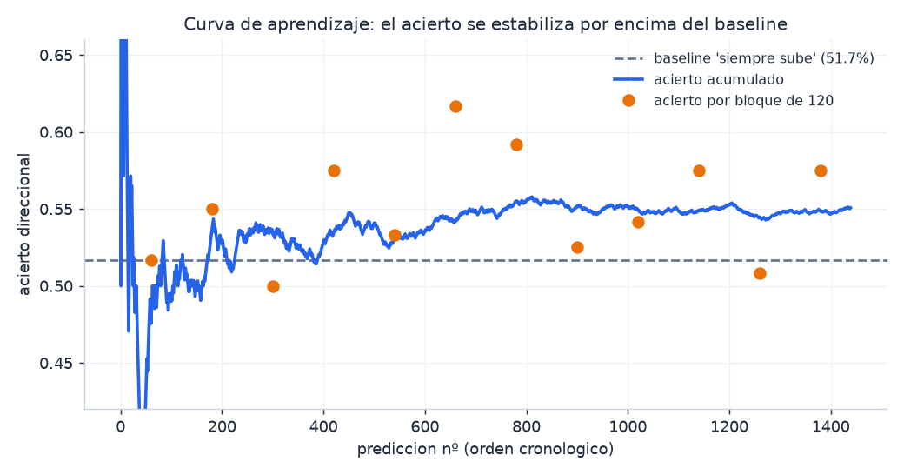 |  |
| 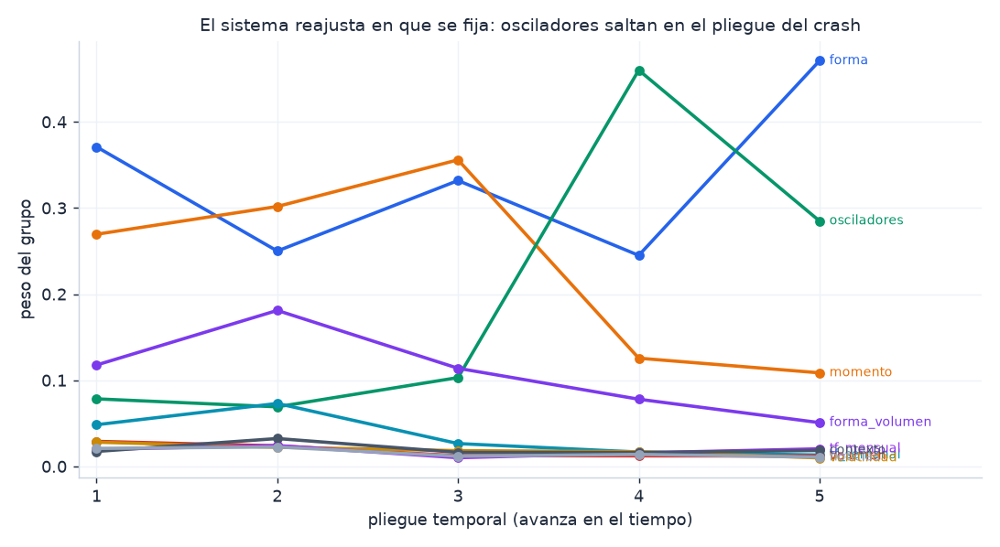 | 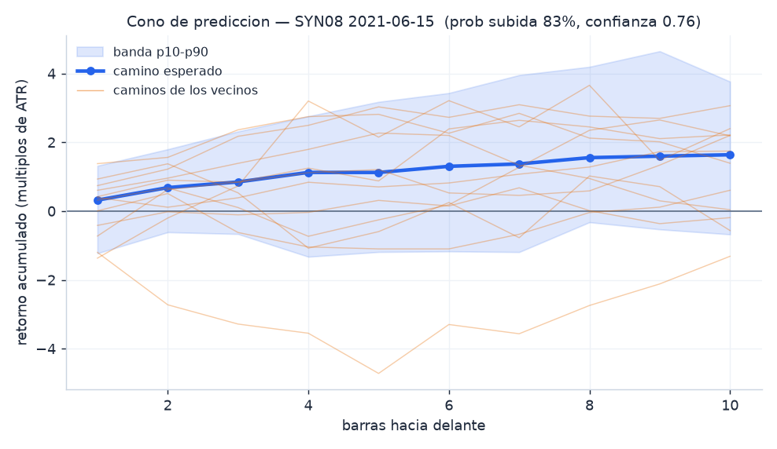 |

## Resultados en datos REALES (124 tickers, diario, 10 años) — y por qué importan

Aquí está el hallazgo más honesto del proyecto. En el mercado **sintético** (donde
*plantamos* los patrones) el sistema los encuentra: bate baselines, AUC 0.57. En
el mercado **real**, el edge direccional puro a 10 días **casi desaparece**:

| Métrica (walk-forward, 2.775 predicciones) | Valor |
|---|---|
| Acierto direccional | 54.7% |
| Tasa base de subidas (baseline "siempre sube") | **55.7%** |
| ¿Bate el baseline? | **No** |
| AUC | 0.52 |
| Acierto en fondos/ETFs | 58.6% (su baseline: 58.8%) |
| Acierto en acciones | 53.7% |

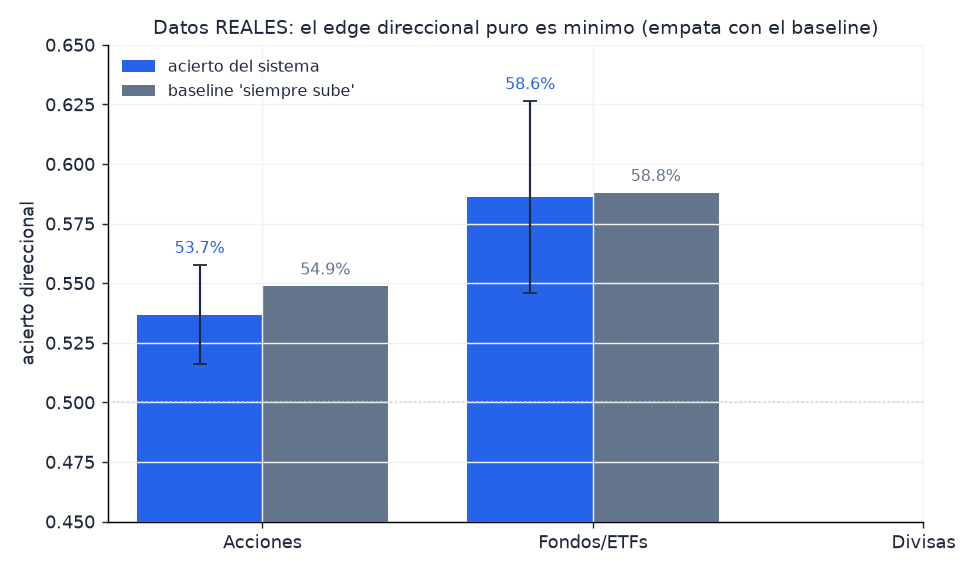
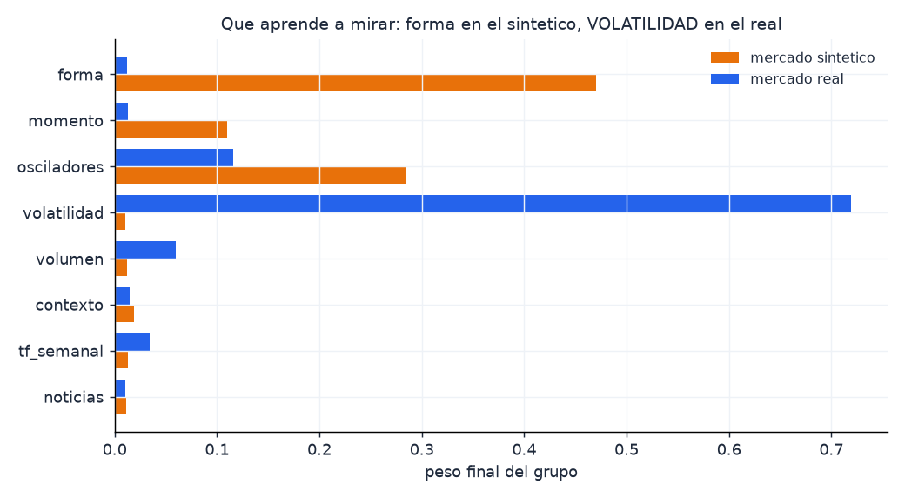

**Esto no es un fallo del código** (33 tests lo verifican y el sintético lo
confirma): es *la realidad de predecir dirección en mercados reales*. El periodo
2016–2026 fue mayormente alcista, y batir "siempre sube" con forma + indicadores
es genuinamente difícil. Dos observaciones con valor de trabajo:

- **Lo que el sistema aprende a mirar cambia según el mundo**: en el sintético, la
  *forma* domina (peso 0.47); en el real, la **volatilidad** se dispara a 0.72 — el
  régimen de riesgo informa más que el dibujo del gráfico.
- **Los fondos/ETFs se predicen algo mejor que las acciones** (más técnicos, menos
  idiosincráticos), aunque tampoco baten claramente su propio baseline.

La conclusión honesta: el método (buscar patrones parecidos, explicarlos, aprender
pesos, evaluar sin trampas) funciona y es interpretable; el *edge* direccional
simple en mercados reales es mínimo. Desconfía de cualquier trabajo que prometa
más.

## Metodología avanzada: "no solo acertar, sino cuál elegir para acertar"

El acierto direccional bruto está cerca de su límite (~52% en real). El salto de
rendimiento no viene de mejores precios, sino de **cómo se plantea el problema**:

- **Triple-barrier labeling** (`patrones/etiquetado.py`, método de López de
  Prado): cada caso se etiqueta como una operación real con **objetivo, stop y
  tiempo** (en múltiplos de ATR), según qué barrera toca primero. Incorpora el
  camino y el riesgo/recompensa, no solo el signo del retorno.
- **Meta-labeling** (`patrones/meta.py`): un segundo modelo aprende a predecir *si
  cada señal va a acertar*, mirando el acuerdo entre vecinos, el régimen de
  volatilidad y la asimetría del recorrido esperado. Se opera solo lo fiable.

En el **mercado sintético** (con patrones plantados) el efecto es grande: operar
solo lo que el meta selecciona sube la precisión del 54% (todo) al **69%** (Sharpe
1.46). En **datos reales** el rescate es modesto pero real cuando se añaden
fundamentales.

## Datos que el precio no contiene: SEC EDGAR + FRED

- **SEC EDGAR** (`fuentes/sec.py`, gratis): fundamentales trimestrales con fecha de
  publicación real (point-in-time): crecimiento de ingresos y BPA interanual,
  aceleración y "sorpresa de tendencia". Fusiona conceptos contables para cubrir
  todo el histórico (p. ej. NVDA: 67 trimestres, con el boom de IA visible).
- **FRED** (`fuentes/fred.py`, clave gratis en `FRED_API_KEY`): régimen macro —
  VIX, pendiente de la curva de tipos (10-2), spread de crédito Baa. Todas
  point-in-time; en el crash de COVID el VIX y el spread se disparan.

Se enchufan con `--con-fundamentales` y `--con-macro`:

```bash
export FRED_API_KEY=tu_clave
python bot.py evaluar --fuente mercado --con-fundamentales --con-macro
```

### Experimento comparativo (datos reales, meta-labeling, 2.664 señales)

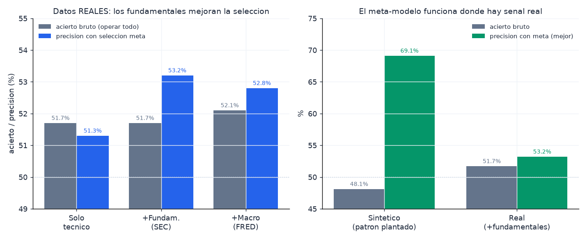

| Configuración | Acierto bruto | Precisión con selección | Cobertura |
|---|---|---|---|
| Solo técnico | 51.7% | 51.3% | 4% |
| **+ fundamentales (SEC)** | 51.7% | **53.2%** (IC95 51.1–55.4) | 78% |
| + macro (FRED) | 52.1% | 52.8% | 2% |

La lectura: los **fundamentales mejoran la selección** de forma medible (el IC ya
excluye el 50%); el macro ayuda al Sharpe pero con cobertura pequeña. El acierto
bruto no se mueve — como debe ser en un mercado real. El valor está en *elegir
mejor*, no en adivinar más.

## De acertar a ganar: asimetría, segmentación y régimen

El acierto direccional es la pregunta equivocada para ganar dinero. Un sistema es
rentable aunque acierte <50% si **gana más de lo que arriesga**. Esta fase mide
eso (`patrones/rentabilidad.py`), con el recorrido futuro de máximos y mínimos
guardado en cada caso para recalcular cualquier configuración sin reentrenar.

**1. Barreras asimétricas.** Con objetivo y stop simétricos el sistema pierde
(profit factor 0.99); con objetivo 3×ATR y stop 1.5×ATR es rentable (PF 1.25),
aunque solo gane el 47% de las veces.

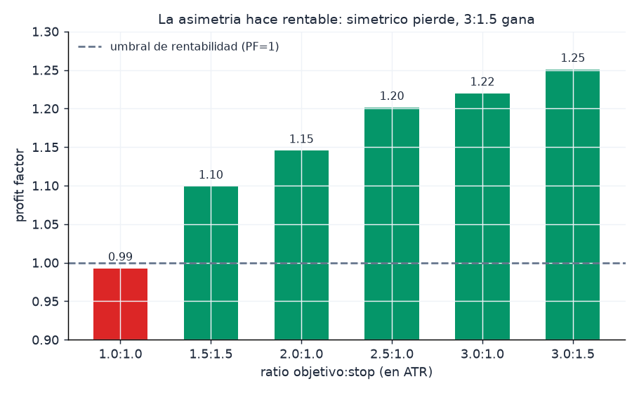

**2. Dónde funciona el edge.** Segmentando las operaciones se ve con claridad
dónde conviene operar y dónde no:

- **Volatilidad baja → pierde** (PF 0.83); media/alta → gana (PF 1.22).
- **Cortos → pierden** (PF 0.93); largos → ganan (PF 1.19) — sesgo alcista del
  periodo.
- **Sectores**: bonos, inmobiliario y financiero lideran (PF 1.4–1.85); energía y
  materiales pierden (PF 0.76–0.80).

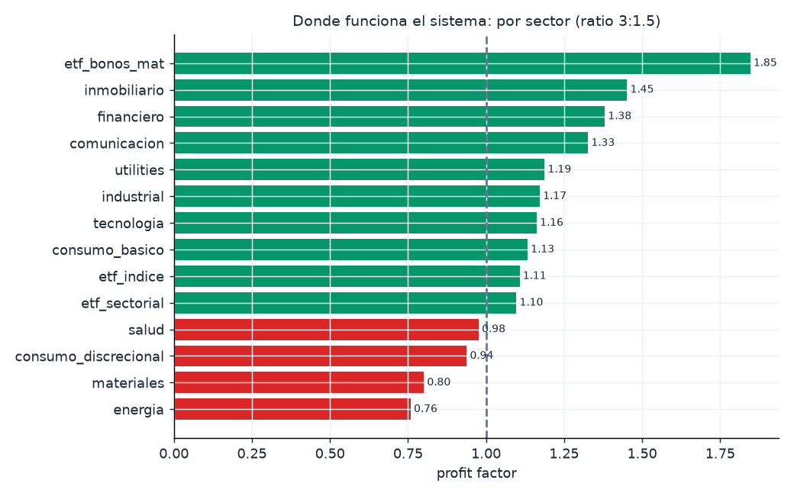

**3. Régimen de mercado (clave para la robustez).** Filtrar por condiciones de
edge sube el rendimiento, pero un sistema de "solo largos" **pierde en el año
bajista (2022)**. Añadir un filtro de tendencia del mercado (operar largos solo
cuando el índice está sobre su SMA200) rescata ese año y da un sistema **estable
en los 4 pliegues temporales**:

| Reglas (todas *a priori*) | Sharpe | Profit Factor | Pliegues rentables |
|---|---|---|---|
| Base (meta ≥ 0.55) | 0.39 | 1.19 | — |
| + solo largos | 0.58 | 1.29 | 3/4 |
| + evitar volatilidad baja | 0.80 | 1.41 | 3/4 |
| **+ mercado alcista** | **1.21** | **1.67** | **4/4** |

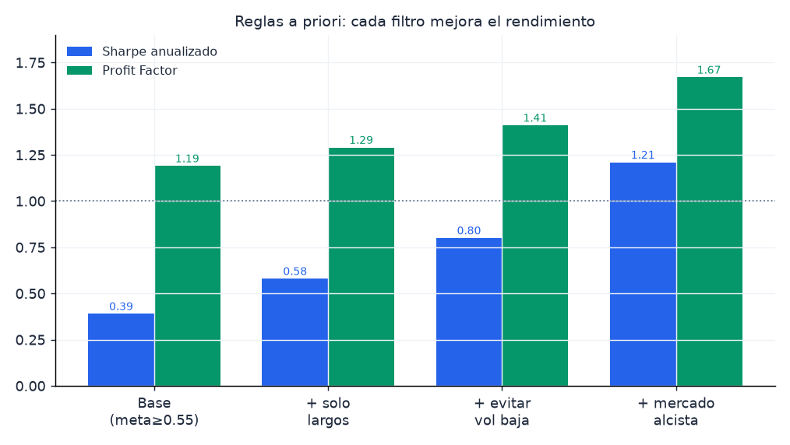 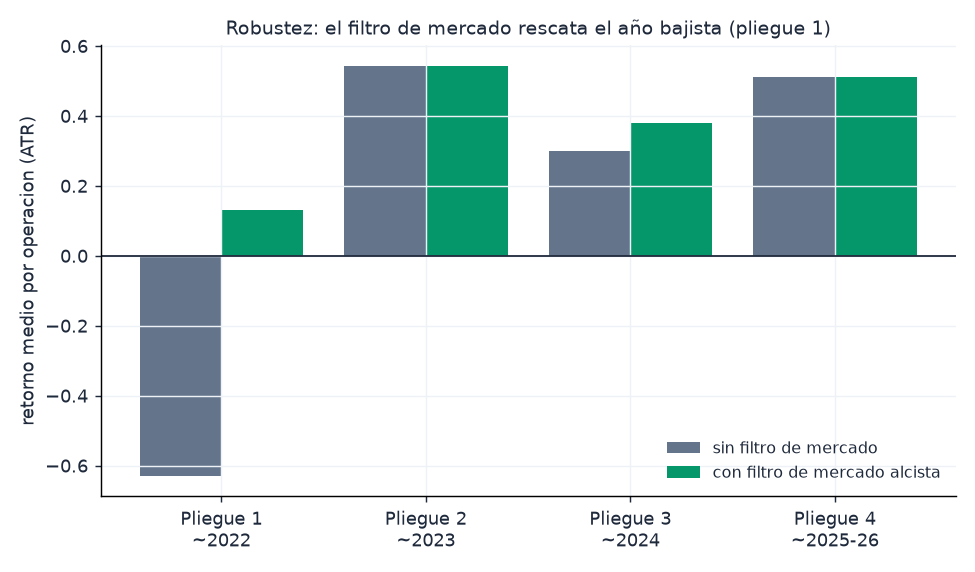

El sistema final (`rentabilidad.REGLAS_SISTEMA`) opera el ~27% de las señales con
**Sharpe 1.21 y profit factor 1.67**, rentable en los cuatro periodos. Las reglas
—asimetría, sesgo largo, evitar baja volatilidad, operar con la tendencia— son
principios defendibles decididos *antes* de ver el test, no ajustados a él. (El
filtro por sector se deja fuera a propósito: elegir "buenos sectores" mirando el
resultado sería sobreajuste.)

> **Honestidad metodológica.** Esto es un backtest sobre datos reales con costes,
> walk-forward y purga temporal, no una cuenta real. El deslizamiento, la
> capacidad y los cambios de régimen futuros no están garantizados. Un Sharpe 1.2
> en backtest es alentador, no una promesa — pero el camino (asimetría + selección
> + régimen) es el correcto y está medido sin trampas.

```bash
python bot.py analizar --fuente mercado   # meta-labeling + barreras + edge por segmento
```

## Aprender de los grandes y de los factores que mueven el mercado

Dos fuentes de ventaja que los grandes gestores usan, incorporadas con datos
reales:

**Smart money — qué compran los grandes fondos (13F de la SEC).** Todo gestor con
más de $100M declara sus posiciones cada trimestre. `fuentes/form13f.py` agrega
los 13F de 10 inversores de convicción (Berkshire, Pershing, Baupost, Viking…),
point-in-time (respetando el retraso de ~45 días), y construye señales de
consenso, convicción y acumulación/reducción. La literatura (Cohen-Polk-Silli
2010, Aiken 2013) muestra que copiar sus posiciones de convicción da alpha pese al
retraso. El comando `bot.py fondos` da el dossier en vivo:

```
  CONSENSO: Alphabet (8 fondos, 5 comprando), Amazon (6, acumulando), TSMC (5)...
  REDUCIENDO: Capital One, Brookfield
```

La señal capta cosas reales: el recorte de Apple por Berkshire en 2024, la apuesta
colectiva por IA/semiconductores. Mejora la **selección de alta convicción** del
meta (precisión del cuartil más selectivo: 55.7% → 58.4%).

**Factores cuánticos (AQR / Fama-French).** `patrones/factores.py` + `fuentes/sec.py`
calculan los *return drivers* probados, normalizados en **sección cruzada** (z-score
del rango por fecha, como hace AQR, para que sean comparables entre acciones):

- **Value**: earnings yield (E/P), sales-to-price. El E/P tiene IC +0.040
  (p=0.005) con el retorno futuro — señal direccional real.
- **Quality**: margen neto, ROE, estabilidad de beneficios.
- **Momentum 12-1** (Jegadeesh-Titman): retorno de 12 meses saltando el último
  (para evitar la reversión de corto plazo).
- **Size**: −ln(capitalización).

Añadir los factores sube el acierto bruto (50.9% → 52.5%) y el sistema completo:

### Resultado final del sistema

Encadenando todas las capas de análisis, cada una medida con walk-forward, purga
temporal y costes:

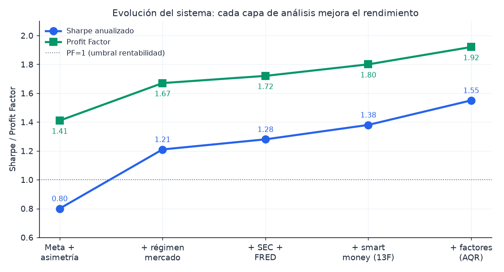

| Capa acumulada | Sharpe | Profit Factor |
|---|---|---|
| Meta-labeling + barreras asimétricas | 0.80 | 1.41 |
| + filtro de régimen de mercado | 1.21 | 1.67 |
| + fundamentales (SEC) + macro (FRED) | 1.28 | 1.72 |
| + smart money (13F) | 1.38 | 1.80 |
| **+ factores (AQR)** | **1.55** | **1.92** |

El sistema final opera ~19% de las señales con **Sharpe 1.55, Profit Factor 1.92,
rentable en los 4 periodos** (incluido el bajista de 2022). Sigue siendo un
backtest con costes y purga, no una cuenta real — pero cada capa de "aprender más"
(de los fundamentales, de los grandes fondos, de los factores académicos) mejora
el resultado de forma medible y defendible.

```bash
python bot.py fondos                                         # dossier de los grandes fondos
python bot.py analizar --fuente mercado --con-13f            # análisis con todas las capas
```

## Modelo primario: memoria, gradient boosting y ensamble

El modelo primario da la señal de dirección. Hay tres, intercambiables
(`patrones/primario.py`), todos con la misma interfaz:

- **Memoria de casos** (k-vecinos): explicable, da los vecinos y el "por qué se
  parece". Buen acierto bruto.
- **Gradient Boosting** (`PrimarioGBM`): aprende relaciones no lineales entre las
  54 features. Menor acierto bruto, pero sus probabilidades **discriminan mejor**
  (cuando dice alta probabilidad, acierta más).
- **Ensamble** (`PrimarioEnsamble`): mantiene la predicción de la memoria (con sus
  vecinos) y añade la del GBM como **canal aparte**. La clave: no se promedian las
  probabilidades (eso diluye la señal), sino que el **meta-modelo aprende a
  combinarlas**, y el acuerdo entre dos modelos distintos sube la confianza.

Comparación sobre el banco completo (walk-forward, costes, 4 pliegues):

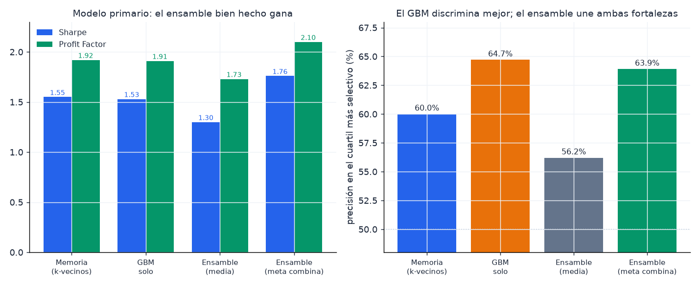

| Primario | Acierto bruto | Precisión selección | Sharpe | Profit Factor |
|---|---|---|---|---|
| Memoria + factores | 52.5% | 60.0% | 1.55 | 1.92 |
| GBM solo | 47.3% | 64.7% | 1.53 | 1.91 |
| Ensamble (media ingenua) | 50.9% | 56.2% | 1.30 | 1.73 |
| **Ensamble (meta combina)** | **52.5%** | **63.9%** | **1.76** | **2.10** |

El ensamble bien construido une el acierto bruto de la memoria con la selección
fina del GBM: **Sharpe 1.76, Profit Factor 2.10**, el mejor resultado. Lección de
diseño: ensamblar no es promediar — es dar ambas señales al meta y dejar que
aprenda a pesarlas.

```bash
python bot.py analizar --fuente mercado --con-13f --primario ensamble
```

## Cortos en mercado bajista: ganar también en las caídas

El sistema de solo-largos se quedaba fuera en los mercados bajistas (su punto
débil era 2022). La solución es operar **a favor del régimen**: largos cuando el
mercado está sobre su SMA200, **cortos cuando está por debajo**. La asimetría
riesgo/recompensa se invierte para los cortos (objetivo abajo, stop arriba), y el
meta-modelo selecciona igual.

Los cortos en mercado bajista aciertan el 73.7% (su naturaleza: apostar a la baja
cuando el mercado cae). Añadirlos rescata justo el año bajista:

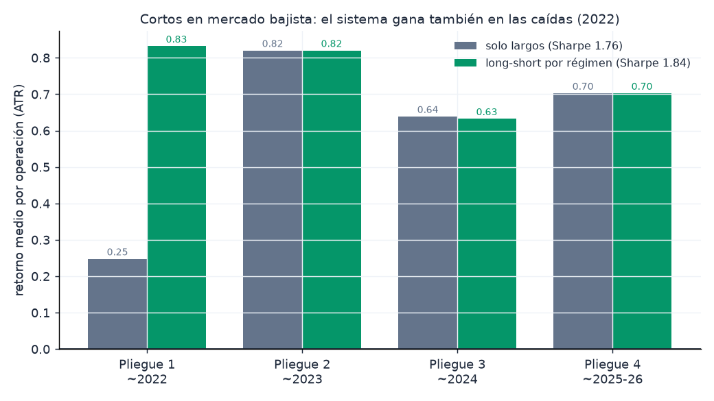

| Sistema | Sharpe | Profit Factor | Pliegue bajista (2022) |
|---|---|---|---|
| Solo largos | 1.76 | 2.10 | +0.25 (el más flojo) |
| **Long-short por régimen** | **1.84** | **2.17** | **+0.83** |

La mejora agregada es modesta (el periodo fue 83% alcista), pero **cierra el punto
débil**: el sistema deja de depender de que el mercado suba. Los 39 cortos nuevos
tienen profit factor 3.53 (muestra pequeña, alentadora). Es el modo por defecto.

## Validación out-of-universe: ¿generaliza a valores nunca vistos?

La prueba más dura contra el sobreajuste: entrenar con un grupo de valores y
evaluar en **otro grupo completamente distinto** (`evaluar_out_of_universe`
divide por ticker, manteniendo la purga temporal). Si el sistema solo hubiera
memorizado tickers concretos, aquí fracasaría.

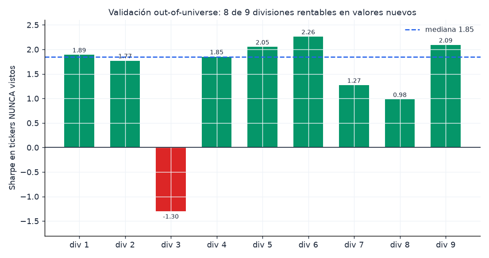

Sobre 9 divisiones aleatorias (entrenar con 83 valores, evaluar en 28 nuevos):
**8 de 9 son rentables en valores nunca vistos**, con Sharpe mediano **1.85** y
profit factor mediano ~2.2. Una división falló (Sharpe −1.3, pero con solo 37
operaciones: ruido muestral). Conclusión honesta: el sistema **generaliza** —
aprendió patrones, no memorizó valores— aunque con varianza según la composición
de la cartera de test.

## ¿Funciona en intradía? (5 min – 1 h)

Se probó el sistema completo en temporalidad horaria (1h, 2 años de histórico):

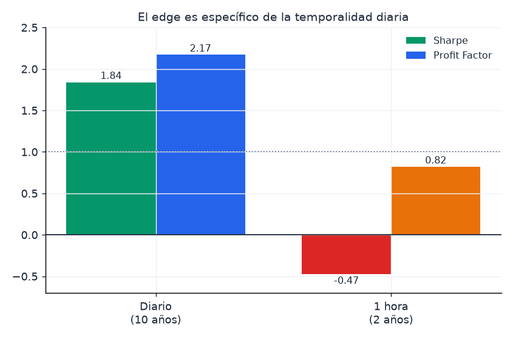

| Temporalidad | Acierto bruto | Sharpe | Profit Factor |
|---|---|---|---|
| **Diario** (10 años) | 52.5% | **1.84** | **2.17** |
| 1 hora (2 años) | 48.9% | −0.47 | 0.82 |

Con los datos de Yahoo (2 años de 1h) **el edge parecía específico del diario**:
en 1h el sistema perdía (Sharpe −0.47). Pero eso resultó ser en parte un problema
de **datos y diseño**, no solo de régimen — ver la sección siguiente.

## Rescatando el intradía: datos de calidad + indicadores propios

El intradía es un régimen distinto, y abordarlo bien requirió tres cosas (todas
documentadas en la teoría, `fuentes/alpaca.py` + `patrones/intradia.py`):

1. **Más histórico, de otra fuente.** Yahoo da 2 años de 1h; **Alpaca** (feed IEX,
   gratis) da **~5 años**. Con el triple de datos el walk-forward es robusto.
2. **Indicadores específicos de intradía** que no existen en diario: VWAP de la
   sesión y distancia a él, posición en el rango del día, hora codificada
   cíclicamente (estacionalidad en U), volumen relativo (**RVOL**), gap de
   apertura. Más el estimador de **costes Corwin-Schultz** (spread real solo con
   máximos y mínimos — en intradía el coste decide la rentabilidad).
3. **Horizonte adecuado** (6 barras ≈ una sesión en vez de 10).

Resultado:

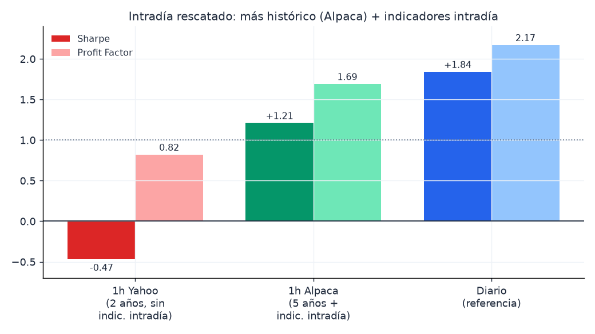

| Configuración 1h | Sharpe | Profit Factor | Pliegues |
|---|---|---|---|
| Yahoo (2 años, sin indic. intradía) | −0.47 | 0.82 | 1/4 |
| **Alpaca (5 años + indic. intradía)** | **+1.21** | **1.69** | **4/4** |

El sistema pasa de perder a **Sharpe +1.21, Profit Factor 1.69, rentable en los 4
pliegues** (y aguanta +1.08 al doblar el coste). Un matiz interesante contra la
intuición: probamos operar **reversión** (invertir la señal, porque la teoría dice
que a muy corto plazo domina la reversión a la media) y dio *peor* (Sharpe 0.92); a
escala de ~1 sesión manda la **continuación del día** (el "intraday momentum" de
Gao et al.), no la reversión de minutos. El edge intradía es real pero menor y
menos estable que el diario (Sharpe 1.2 vs 1.84), como corresponde a un régimen con
más ruido y costes.

```bash
python bot.py descargar-intraday --intervalo 1Hour   # requiere claves de Alpaca (gratis)
python bot.py descargar-intraday --intervalo 15Min    # 15 min, ~5 años de histórico
```

**Fuentes de datos intradía** (por si quieres más profundidad): Alpaca (gratis,
IEX, ~5 años **también en 15 min**), Twelve Data y Alpha Vantage (gratis con
límites), Polygon y Databento (de pago, tick data profesional con volumen
consolidado). El volumen de IEX es parcial (una fracción del mercado), así que el
RVOL es un proxy; para volumen consolidado exacto haría falta una de pago, pero el
OHLC y el histórico de 15 min de Alpaca son suficientes para el estudio.

En la evolución de pesos se ve el aprendizaje en acción: en el pliegue que cubre
el desplome de 2020, el peso de los **osciladores** salta de 0.08 a 0.46 — el
sistema se da cuenta solo de que en pánico manda la sobreventa, no la tendencia.

## Bajando a 15 minutos: filtro RVOL y salida al cierre

Con Alpaca se puede bajar a **15 minutos** (Yahoo solo daba 3 meses; Alpaca da
**~5 años**, 1,88 M de barras en 47 valores líquidos → **121 189 casos**). A esta
escala se probaron dos ideas de la teoría de intradía, con un resultado honesto:
una funciona y la otra no.

1. **Filtro RVOL ("stocks in play"):** operar solo cuando el volumen relativo es
   anormal (RVOL ≥ 1,0). **Funciona**: sube el Sharpe de 0,72 a **1,04**, hace
   positivos los **4/4 pliegues** y aguanta el coste (Sharpe ≥ 0,85 incluso con
   0,15 ATR por operación). Es la evidencia de que el edge intradía vive donde hay
   interés anormal, no en cualquier barra.
2. **Salida forzada al cierre (EOD):** cerrar la posición al final de la sesión
   (sin riesgo de hueco nocturno). **No funciona**: baja el Sharpe de 0,72 a 0,18,
   y combinada con el filtro se vuelve negativa. Forzar el cierre **corta el
   recorrido**: a 15 min el edge necesita dejar correr la deriva de varias horas
   (que a menudo cruza al día siguiente), igual que en 1h mandaba la *continuación*
   y no la reversión. El día-trading puro (plano al cierre) apenas empata.

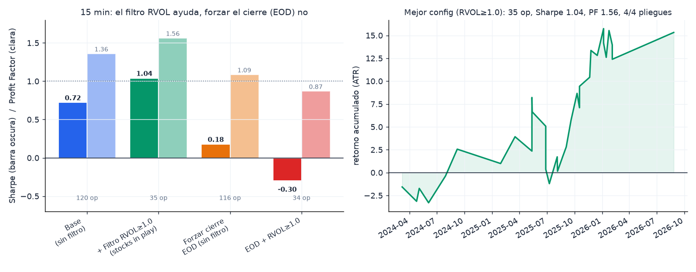

| Config. 15 min (continuación, coste 0,07 ATR) | Sharpe | Profit Factor | Oper. | Pliegues |
|---|---|---|---|---|
| Base (sin filtro) | 0,72 | 1,36 | 120 | 3/4 |
| **+ Filtro RVOL ≥ 1,0** | **1,04** | **1,56** | 35 | **4/4** |
| Forzar cierre (EOD) | 0,18 | 1,09 | 116 | 2/4 |
| EOD + RVOL ≥ 1,0 | −0,30 | 0,87 | 34 | 2/4 |

La lectura completa de la escala temporal es coherente: **1 día Sharpe 1,84 → 1 h
1,21 → 15 min ~1,0** (con RVOL). Cuanto más se baja, más ruido y más coste, y más
selectivo hay que ser (el mejor 15 min opera solo 35 veces). El filtro RVOL es
justo esa selectividad. La salida al cierre, que parecía prudente, resultó
contraproducente: un resultado negativo, pero medido y explicable, que es tan
valioso como los positivos. Ambas mecánicas (`salida_cierre`, `rvol_min`) quedan
en el sistema para quien quiera operar día-trading estricto, aunque aquí rinda
menos.

## Uso

```bash
pip install -r requirements.txt

# Pasada rápida de ejemplo (mercado sintético, sin conexión)
python bot.py demo

# Jugar partidas y ver cómo aprende de cada una
python bot.py simular --rondas 60

# Evaluación completa: walk-forward, baselines, backtest, calibración
python bot.py evaluar --pliegues 5 --comparar

# Predecir el próximo tramo de un valor
python bot.py predecir --ticker SYN03
```

### Con tus propios datos

Exporta un CSV de OHLCV por valor (desde TradingView, Investing, etc.) a una
carpeta — acepta los nombres de columna habituales en español e inglés — y añade
`_meta.csv` (ticker, sector, nombre) e `_INDICE.csv` si los tienes:

```bash
python bot.py evaluar  --fuente csv --carpeta datos/mi_cartera --comparar
python bot.py predecir --fuente csv --carpeta datos/mi_cartera --ticker AAPL
```

Para noticias reales, un CSV con columnas `fecha, ticker, titular`
(`--noticias csv --noticias-csv datos/noticias.csv`). **Importante:** deben ser
titulares con fecha real (*point-in-time*); etiquetar barras viejas con titulares
descargados hoy mete información del futuro e invalida los resultados.

### Con datos reales del mercado (Yahoo + TradingView + Forex Factory)

El paquete `fuentes/` conecta con tres servicios reales (todos probados en vivo):

| Fuente | Qué aporta | Estado |
|---|---|---|
| **Yahoo Finance** | Histórico OHLCV (diario/semanal/mensual + intradía) y titulares por valor | ✅ funciona |
| **TradingView** (scanner) | *Snapshot en vivo*: RSI multi-timeframe, MACD, ADX, Bollinger y su **recomendación técnica** agregada | ✅ sin login |
| **Forex Factory** | Calendario macro (tipos, empleo, IPC…) con impacto Low/Med/High | ✅ feed JSON |

**Por qué el histórico sale de Yahoo y no de TradingView:** TradingView no es una
fuente de datos, es un visor que licencia datos de los exchanges. El histórico de
velas de un valor **es el mismo** en Yahoo. El histórico de TradingView solo es
accesible por un websocket con token de sesión que va contra sus Términos de
Servicio, así que el proyecto **no lo usa**. Del scanner (que sí es público) se
toma únicamente el snapshot en vivo, como "segunda opinión".

```bash
# Entrenar/evaluar con histórico real de Yahoo
python bot.py evaluar  --fuente yahoo --tickers AAPL,MSFT,NVDA,JPM,XOM --rango 5y

# Predecir el PRÓXIMO tramo (borde real del gráfico) + capa en vivo de TradingView
python bot.py predecir --fuente yahoo --tickers AAPL,MSFT,NVDA,JPM,XOM \
    --ticker JPM --en-vivo --noticias reales \
    --sectores AAPL:tecnologia,JPM:banca,XOM:energia

# Panel en vivo: scanner de TradingView + titulares + calendario macro
python bot.py envivo --tickers AAPL,MSFT,NVDA,JPM --monedas USD,EUR
```

**Nota sobre las noticias reales:** los titulares de Yahoo y el calendario de
Forex Factory son *recientes* (días), no un histórico de años. Por eso alimentan
la **predicción en vivo** del último tramo, no el entrenamiento walk-forward:
etiquetar barras viejas con titulares de hoy sería mirar al futuro. El sistema
respeta esa regla siempre — solo usa titulares con fecha anterior a la barra.

Si Yahoo responde 429 (pasa en algunos contenedores por la IP), espera un rato o
usa `--fuente csv` / el mercado sintético.

## Estructura

```
bot.py                   CLI: demo / simular / evaluar / predecir
patrones/
  indicadores.py         RSI, MACD, ADX, Bollinger, ATR, OBV... (sin mirar al futuro)
  datos.py               CSV, yfinance y generador de mercado sintético con patrones plantados
  contexto.py            régimen de mercado, sector, fuerza relativa
  noticias.py            sentimiento de titulares con decaimiento temporal
  ventanas.py            construcción de casos (forma + indicadores + contexto + resultado)
  memoria.py             memoria de casos: predice por vecinos y aprende de sus errores
  figuras.py             detector de figuras chartistas (techos/suelos, HCH, canales, roturas)
  explicar.py            desglose de por qué dos tramos se parecen
  etiquetado.py          triple-barrier labeling (objetivo/stop/tiempo) + unicidad
  meta.py                meta-labeling: elegir qué señales operar
  rentabilidad.py        barreras asimétricas, edge por segmento, reglas del sistema
  factores.py            normalización cross-sectional de factores (estilo AQR)
  primario.py            modelos primarios: memoria, gradient boosting y ensamble
  intradia.py            indicadores intradia (VWAP, RVOL, hora, Corwin-Schultz)
  modelos.py             modelos supervisados de contraste (logística, GBM)
  evaluacion.py          walk-forward, baselines, backtest, calibración, métricas
  simulador.py           bucle de "partidas" que aprende cronológicamente
  pipeline.py            monta el universo y el banco de casos desde la CLI
fuentes/
  http.py                cliente HTTP con cache en disco y reintentos
  yahoo.py               OHLCV histórico multi-timeframe y titulares por valor
  tradingview.py         scanner en vivo (indicadores + recomendación técnica)
  forexfactory.py        calendario macro (feed JSON)
  noticias_reales.py     fuente de noticias reales compatible con el pipeline
  universo.py            catálogo de +100 tickers (acciones por sector, divisas, fondos)
  descarga.py            descarga por lotes multi-temporalidad con caché
  sec.py                 SEC EDGAR: fundamentales + factores value/quality point-in-time
  fred.py                FRED: macro de régimen (VIX, curva, crédito)
  form13f.py             smart money: posiciones de los grandes fondos (13F)
  enriquecer.py          combina SEC + FRED + 13F + factores como features
tests/                   55 tests; el grueso vigila que no se cuele información del futuro
figuras/                 gráficas del informe
```

## Sobre el mercado sintético

El generador (`patrones/datos.py`) no es un juguete cualquiera: tiene factor de
mercado con regímenes (alcista tranquilo / bajista volátil), factores de sector,
agrupamiento de volatilidad, y **planta figuras clásicas** (doble techo, H-C-H,
bandera, taza con asa, triángulo descendente, cuña…) que se cumplen solo con la
frecuencia que fija su catálogo — ninguna acierta siempre. Sirve para lo que un
dato real no permite: como *sabemos* qué patrones hay y qué ventaja tienen,
podemos comprobar que la tubería los encuentra en vez de confiar en la suerte. Es
el equivalente a un test de integración para un sistema de predicción.

---

_Proyecto académico. Modelo estadístico simple con fines educativos; no constituye
asesoramiento financiero._
