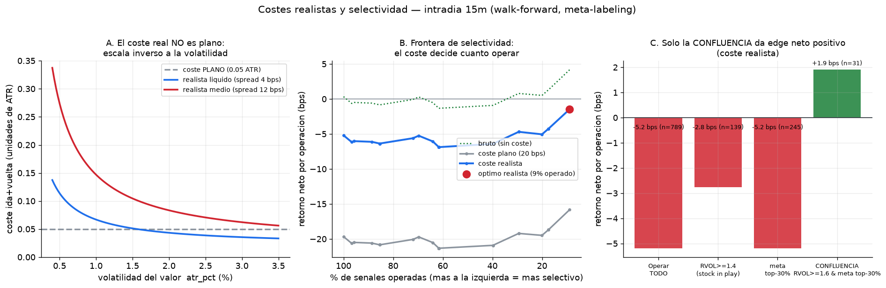

# Costes realistas y selectividad en el intradía 15m (diagnóstico honesto)

Estudio de cómo los **costes de transacción realistas** afectan al edge del
sistema intradía de 15 minutos, y qué selectividad lo hace neto‑positivo. Sobre
un *walk‑forward* con meta‑labeling: 12 valores líquidos (AAPL, AMD, NVDA, JPM,
MU, COST…), 2021–2026, **789 operaciones** de test. Es un **diagnóstico**, no un
backtest definitivo (universo pequeño, barreras por defecto, horizonte 8 barras).

## Qué se mide

El coste plano del backtest (`coste_atr=0.05` en ATR, o 20 bps en retorno) se
sustituye por un modelo realista (`patrones/costes.py`):

    coste ida+vuelta = (spread + comisión) / atr_pct + slippage_atr

El spread y la comisión se pagan en **precio** (bps), así que en unidades de
**riesgo (ATR)** escalan **inversamente con la volatilidad** del valor.

## Hallazgos (honestos)

1. **El coste real NO es plano (panel A).** En unidades de ATR, mover un valor de
   `atr_pct=0.8%` cuesta más del doble que uno de `atr_pct=2%`. El coste plano de
   0.05 ATR cruza la curva realista justo en `atr_pct≈1.5%`: **infravalora** el
   coste de operar valores de baja volatilidad y **sobreestima** el de alta. →
   Conclusión operativa: el *churn* de baja volatilidad es caro en riesgo; hay que
   empujar la selección hacia los valores con volatilidad y catalizador.

2. **En large‑caps líquidas el coste realista es ~5.5 bps** (p10–p90: 5.1–6.1),
   bastante menor que el plano de 20 bps. El 20 bps plano era **pesimista** para
   blue chips; el problema no es el coste, es el edge bruto.

3. **El edge bruto por operación es finísimo (panel B):** ~+4 bps en el mejor
   caso (máxima selectividad), ~0 operando ancho. **No sobrevive** ni a 5.5 bps a
   ningún nivel de selectividad cuando se opera de forma amplia: el retorno neto
   realista es ligeramente **negativo** en todo el barrido de umbral del meta.

4. **RVOL sólo no rescata el intradía en blue chips.** El edge bruto mejora hasta
   `RVOL≈1.4` (+3 bps, 55% acierto) pero por encima de `RVOL≥1.6` **empeora**
   (bruto negativo): en una large‑cap un pico de RVOL suele revertir, no es el
   catalizador sostenido de un verdadero *stock in play* de mediana capitalización.

5. **Sólo la CONFLUENCIA da edge neto positivo (panel C):** `RVOL≥1.6` **Y** meta
   en el top‑30% → **+1.9 bps netos, 58% de acierto** (n=31). Muestra pequeña, pero
   apunta en la misma dirección que toda la investigación: el edge no está en un
   filtro suelto, sino en **exigir varias señales a la vez**.

## Qué implica para perfeccionar el algoritmo

- **El intradía NO busca su edge en blue chips.** Hay que cazar *stocks in play*
  de verdad (medianas con catalizador fresco). Es justo lo que hace el sistema en
  vivo: filtro por RVOL + noticias + ranking de convicción (`gestionar.py`).
- **Exigir confluencia, no filtros sueltos.** RVOL alto por sí solo no basta; RVOL
  + convicción del meta sí. Esto refuerza el *gate* de catalizador y el ranking de
  convicción añadidos a la operativa en vivo.
- **Usar costes por valor, no planos.** Integrado ya: `aplicar_sistema(...,
  coste_atr="realista")` castiga correctamente el *churn* de baja volatilidad.
- **Honestidad:** en este universo/configuración el 15m no tiene un edge neto
  fiable operando ancho. El valor está en la selectividad extrema por confluencia,
  que es el principio que guía la operativa en vivo.

## Reproducir

El `res` se construye con `bot.py evaluar --fuente csv --carpeta
datos/intraday/15Min` (datos cacheados); el modelo de costes vive en
`patrones/costes.py` y la figura en `figuras/26_costes_realistas.png`.
