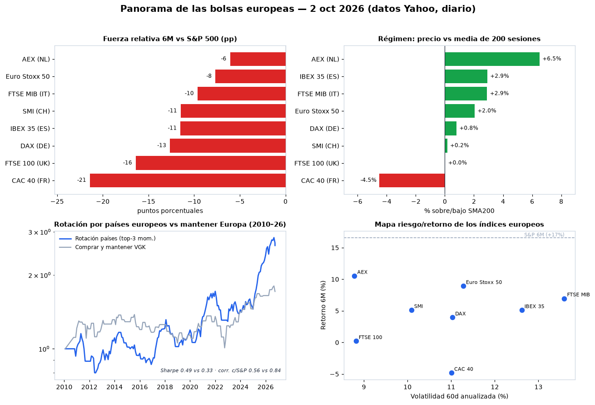

# Análisis profundo de las bolsas europeas — 2 de octubre de 2026

Datos reales vía Yahoo Finance (`fuentes/yahoo.py`), diarios al cierre del 1-oct y
sesión en curso del 2-oct. Análisis hecho para decidir **qué y cómo operar en Europa**.

## 1. Foto de mercado (tabla maestra)

| Índice | Precio | 1M | 3M | 6M | 12M | vs SMA200 | Régimen | Vol 60d | DD 52s |
|---|---:|---:|---:|---:|---:|---:|---|---:|---:|
| Euro Stoxx 50 (zona €) | 6.202 | −2,8 | −1,9 | +8,9 | +12,2 | +2,1% | **ALCISTA** | 11,3 | −5,3 |
| Stoxx 600 (Europa) | 629 | −3,0 | −2,6 | +5,5 | +12,7 | +0,9% | **ALCISTA** | 8,4 | −4,7 |
| DAX (Alemania) | 25.047 | −3,7 | −1,6 | +4,0 | +2,7 | +0,9% | **ALCISTA** | 11,0 | −5,7 |
| **CAC 40 (Francia)** | 7.866 | −5,1 | −6,8 | −4,8 | −1,4 | **−4,5%** | **BAJISTA** | 11,0 | **−9,9** |
| IBEX 35 (España) | 19.060 | −4,7 | −3,0 | +5,1 | **+22,8** | +2,9% | **ALCISTA** | 12,6 | −5,7 |
| FTSE 100 (UK) | 10.458 | −3,4 | −1,8 | +0,2 | +10,2 | 0,0% | ALCISTA* | 8,8 | −4,1 |
| FTSE MIB (Italia) | 50.355 | −3,6 | −4,0 | +6,9 | +16,4 | +2,9% | **ALCISTA** | 13,6 | −6,3 |
| **AEX (P. Bajos)** | 1.109 | +0,4 | +2,7 | +10,5 | +15,4 | **+6,5%** | **ALCISTA** | 8,8 | **−1,0** |
| SMI (Suiza) | 13.642 | −5,2 | −5,0 | +5,1 | +12,7 | +0,1% | ALCISTA* | 10,1 | −6,8 |
| *S&P 500 (ref.)* | 7.666 | +0,5 | +2,4 | +16,6 | +14,6 | +6,2% | ALCISTA | 11,2 | −1,7 |
| *Nasdaq 100 (ref.)* | 30.502 | +4,9 | +4,0 | +27,0 | +23,6 | +11,1% | ALCISTA | 19,0 | −0,8 |

## 2. Las cinco conclusiones que importan

**(1) Europa está técnicamente alcista pero en una pausa de corto plazo.** 8 de 9
índices siguen sobre su SMA200 (tendencia de fondo intacta), pero **todos menos el
AEX están en rojo en el último mes**: es una corrección dentro de tendencia, no un
giro. Para el intradía esto significa rebotes y consolidación, no persecución de
tendencia fácil.

**(2) EE.UU. sigue mandando — Europa lleva 6 meses quedándose atrás.** El Euro
Stoxx rinde **−7,6pp** menos que el S&P a 6M y el Stoxx 600 **−11pp**. El Nasdaq
(+27% a 6M) es otra liga. *Lección:* mientras dure el liderazgo de la tecnología
US, la beta europea pura no es donde está el dinero; en Europa hay que ser
**selectivo por país y por valor**, no comprar "Europa" en bloque.

**(3) La dispersión entre países es enorme — ahí está la oportunidad.** No existe
"la bolsa europea": existe **España/Italia/Países Bajos fuertes** y **Francia
débil**. El CAC 40 es el único en régimen BAJISTA (−4,5% bajo su SMA200, −9,9% de
drawdown, −21pp vs S&P a 6M) — refleja el estrés fiscal/político francés. El IBEX
lidera a 12M (**+22,8%**, +8pp sobre el S&P), señal de la banca y las utilities
españolas. Esta dispersión es exactamente lo que explota una **rotación por
países** (sección 4).

**(4) El euro es un viento en contra ahora mismo.** EUR/USD 1,1263, **−3,4% a 6M**
y cayendo. Para nosotros (cuenta en $ que compra ETFs/ADRs europeos) un euro que
baja **resta** retorno si no cubrimos divisa. Implicación concreta: hoy **HEDJ**
(Europa con divisa cubierta) es estructuralmente mejor que **VGK/FEZ** (sin
cubrir) mientras el euro se debilite. Hay que vigilar EUR/USD como parte del
análisis europeo, no ignorarlo.

**(5) Europa diversifica, pero menos de lo que parece a nivel índice.** Correlación
diaria Euro Stoxx 50 ↔ S&P 500 (120d) = **0,59**. El FTSE 100 es el más
descorrelacionado del S&P (**0,26**) — por su peso en energía, minería y por la
libra. Los índices continentales están muy correlacionados entre sí (DAX-Euro
Stoxx 0,90), así que diversificar *dentro* de Europa aporta poco; lo que aporta es
**rotar hacia el país con tendencia e irse a liquidez cuando no la hay** (eso sí
baja la correlación a 0,56 — sección 4).

## 3. Qué significa para cómo operamos Europa

- **Intradía (ADRs/ETFs US-listed):** preferir nombres de los países fuertes
  (ASML/holandés, bancos españoles e italianos vía ETF) sobre los franceses. El
  filtro de **fuerza relativa vs SPY** que ya montamos (gate de confluencia) hará
  el trabajo automáticamente: un ADR francés débil no pasará el gate.
- **Divisa:** si abrimos exposición europea de swing, **HEDJ > VGK** mientras
  EUR/USD < su SMA200. Es un detalle que los aficionados ignoran y pesa.
- **Dónde NO estar:** Francia (CAC) hasta que recupere su SMA200. El régimen manda.

## 4. Idea cuant nueva validada: **rotación por países europeos**

Momentum transversal entre los 10 ETFs de país operables en Alpaca (EWG, EWQ, EWP,
EWU, EWI, EWN, EWL, EWD, EWO, EWK): cada mes, largo el **top-3 por momentum a 6
meses** (saltando el último mes para evitar reversión), **solo si el ETF está sobre
su SMA200**; a liquidez lo que no tenga tendencia. Backtest 2010–2026:

| | Rotación países | Mantener Europa (VGK) |
|---|---:|---:|
| CAGR | **6,2%** | 4,6% |
| Volatilidad | **14,5%** | 18,4% |
| Sharpe | **0,49** | 0,33 |
| Max drawdown | **−30,8%** | −33,2% |
| **Corr. mensual con S&P 500** | **0,56** | 0,84 |

**Por qué es interesante:** bate a comprar-y-mantener Europa en todo (más retorno,
menos vol, menos drawdown) y, sobre todo, **es un diversificador**: correlación 0,56
con el S&P frente al 0,84 de la beta europea pura — porque rota y se va a liquidez.
Mismo perfil que el TSMOM: Sharpe modesto en solitario, valor en la descorrelación.

**Hoy elegiría:** Austria (EWO, +24,1% mom. 6M), España (EWP, +17,9%), Países Bajos
(EWN, +14,0%). Coherente con la tabla maestra (IBEX y AEX son los líderes; CAC
excluido por BAJISTA). La lógica se sostiene sola.

**Validación DSR/PBO (reproducible en `validar_libroD.py`, 36 configs, 188 meses) —
honesta:** la config pre-especificada (top-3, momentum 6M saltando 1M, filtro SMA200)
da Sharpe 0,53. **PBO 0,24** (NO sobreajustado) y **DSR vs azar 0,94** → el método es
limpio. PERO el **DSR contra comprar-y-mantener Europa (VGK) es 0,89**, por debajo del
0,95 estándar: su *edge* sobre la beta europea es **marginal**. Veredicto (con
verificación adversarial): **CANDIDATO EN OBSERVACIÓN**, no alfa validada. Se puede
operar en **paper** (riesgo cero, para generar evidencia OOS y medir el slippage real
de los ETFs finos), pero **nunca dinero real** hasta DSR-vs-VGK ≥ 0,95 + slippage
medido + track OOS. Módulo: `operativa_rotacion.py` (auto-limitado, gate de riesgo).

## 5. Nota de método

Todo esto sale de datos **gratuitos** (Yahoo). El `fuentes/yahoo.py` del proyecto
sirve los índices europeos, los ETFs de país y EUR/USD con historia larga y cierre
ajustado. No hizo falta ninguna fuente de pago. Ver `docs/fuentes_datos.md` para la
recomendación completa de infraestructura de datos.
