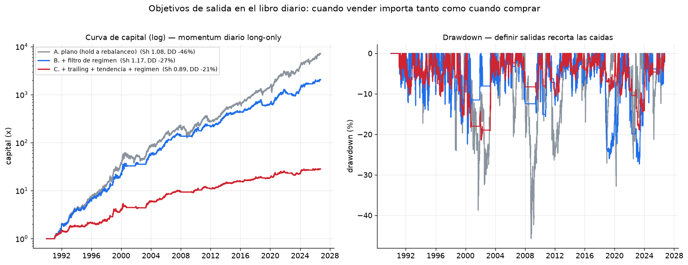

# Objetivos de la estrategia diaria/swing: cuándo comprar y cuándo vender

El libro diario es **momentum transversal long-only** (Jegadeesh-Titman): cada
mes se compra el quintil superior por fuerza relativa 12‑1, equiponderado. La
pregunta que faltaba por responder — y es la mitad del trabajo — es **cuándo
vender**. Aquí están los objetivos, decididos con datos, no por intuición.

## La tesis (qué perseguimos)

Montarse en los valores con más fuerza relativa y **dejarlos correr** mientras
sigan liderando. El momentum tiene *skew positivo*: unos pocos ganadores grandes
hacen el resultado. Por eso la salida no debe cortar la cola derecha.

## Objetivos de ENTRADA

- Universo con liquidez suficiente; momento 12‑1 **positivo**.
- Comprar el **quintil superior** por momento, equiponderado, ~95% invertido.
- Rebalanceo **mensual** (el momentum 12‑1 es lento; rebalancear más es pagar
  costes sin mejorar la señal).

## Objetivos de SALIDA (lo que faltaba)

Validado sobre datos diarios reales (1990–2026, figura 27). Resultado honesto:

| variante | ret anual | vol | Sharpe | maxDD |
|---|---|---|---|---|
| A. plano (hold a rebalanceo) | 23.9% | 22.1% | 1.08 | **−45.8%** |
| **B. + filtro de régimen** | 19.9% | 17.1% | **1.17** | **−27.3%** |
| C. + trailing + tendencia + régimen | 8.6% | 9.6% | 0.89 | −21.4% |
| D. + régimen + disaster stop −20% | 15.6% | 14.3% | 1.09 | −24.5% |
| E. + régimen + rotura 200d | 17.0% | 15.5% | 1.09 | −24.8% |

1. **Decaimiento de momentum (salida natural).** Un valor se vende cuando **cae
   del quintil líder** en el rebalanceo mensual. Mientras lidere, se mantiene
   aunque tenga retrocesos: es un recorte orgánico, no una reversión de tesis.

2. **Filtro de RÉGIMEN (la salida clave, variante B).** Estar **fuera (a
   liquidez)** cuando el mercado está por debajo de su media de 200 sesiones.
   Es lo único que mejora el Sharpe (1.08 → **1.17**) **y** casi **halves** el
   drawdown (−46% → −27%), conservando la mayor parte del retorno. Esquiva los
   *momentum crashes* (Daniel‑Moskowitz 2016), que ocurren en los giros al alza
   desde un suelo de mercado. **Es la regla de salida que adoptamos en vivo.**

3. **Lo que NO hacemos (y por qué).** Trailing stops ajustados y roturas de
   tendencia por valor (C, D, E) recortan algo más el drawdown pero **bajan
   retorno y Sharpe** por debajo de B: sacan al libro de ganadores en
   retrocesos normales (cortan la cola derecha). En el reporte en vivo se
   **muestran** como información ("pierde trailing", "rompe 200d") para ver qué
   líderes flaquean, pero **no disparan venta** por sí solos. Confirma el
   principio del estudio de costes: en momentum, subir el win‑rate cortando
   pronto suele **reducir** la esperanza.

## Cómo opera en vivo

- `operativa.py --revisar` reporta, por posición swing: momento, si sigue líder,
  nivel de trailing (informativo), rotura de tendencia, y el régimen de mercado.
- `operativa.py --revisar --enviar` **protege el libro a liquidez** si el régimen
  es bajista (con un buffer del 1% sobre la media de 200 para evitar flip‑flop).
- `operativa.py --enviar` rebalancea al quintil líder; en régimen bajista el
  objetivo es **liquidez** (no se arma el libro).
- Reglas reutilizables en `patrones/salidas.py`; régimen en
  `operativa.regimen_mercado`.

## Resumen en una frase

Comprar los líderes y dejarlos correr; vender un nombre cuando deja de liderar; y
**salir del mercado entero cuando el mercado pierde su tendencia de largo plazo**
— esa última regla es la que de verdad protege el capital.
