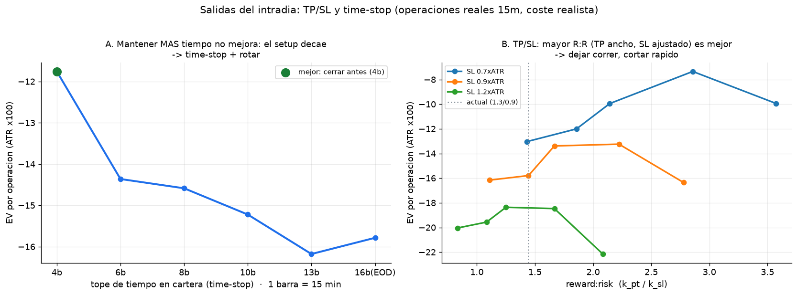

# Salidas del intradía: TP/SL y time-stop (cuándo y por qué)

Igual que en el libro diario, el *cuándo y cómo salir* del intradía se decide con
datos, no por intuición. Validado sobre operaciones reales de 15m (walk-forward,
meta-labeling, 396 trades, coste realista). Aviso honesto: como en el estudio de
costes, en **blue chips** el EV neto es negativo (el edge está en los *stocks in
play*, no en las large-caps); pero el **ranking** de reglas es robusto y es lo que
usamos para decidir.

## 1. TP y SL — cómo se ponen y por qué

El TP y el SL se fijan en múltiplos del **ATR** (volatilidad del propio valor), no
en % fijo: así se adaptan a cada nombre. TP = entrada × (1 + k_pt·ATR%), SL =
entrada × (1 − k_sl·ATR%). Al colocar la orden se usa el **precio actual** (no el
de la señal) para que Alpaca no rechace el bracket.

**Qué k_pt/k_sl (figura 28, panel B):** mayor **reward:risk con SL AJUSTADO** es
consistentemente mejor. Un SL corto (0.7–0.8·ATR) bate a uno ancho (1.2·ATR) en
todos los casos, y un TP ancho deja correr al ganador. Es el principio del *skew
positivo*: **dejar correr al ganador y cortar rápido al perdedor.** Por eso se
ajustó:

| | antes | ahora | reward:risk |
|---|---|---|---|
| 15Min | TP 1.3 / SL 0.9 | **TP 1.6 / SL 0.8** | 1.4 → **2.0** |
| 1Hour | TP 1.5 / SL 1.0 | **TP 1.8 / SL 0.9** | 1.5 → **2.0** |

## 2. Time-stop — qué pasa si una operación lleva mucho abierta

**El hallazgo (figura 28, panel A):** mantener una operación intradía **más tiempo
NO mejora** el resultado — lo **degrada**. El EV por operación es mejor cerrando
pronto (~4 barras ≈ 1h) y empeora de forma monótona hacia el cierre de sesión. La
operación media se resuelve en ~1h; más allá, el pico de RVOL y el momentum de
VWAP que justificaron la entrada **se han disipado**: ya no es la estrategia
intradía, solo es capital y riesgo parados.

**La regla (en `gestionar.revisar_intradia`):**
- **Time-stop en verde — ≥ 90 min (1.5h) y P&L ≥ 0:** recoge el positivo y **rota**
  a una oportunidad fresca. No esperes a que se gire; el edge ya pasó.
- **Time-stop duro — ≥ 150 min (2.5h):** cierra pase lo que pase (el setup ha
  caducado).
- Entre medias, una posición roja pero con **tendencia intacta** se mantiene (es
  un bache orgánico; el SL del bracket protege). No se cierra por estar en rojo.

Esto cierra el círculo con la selectividad: liberar el hueco de una posición que ya
no trabaja permite **reinvertir en la mejor oportunidad del momento** (por
convicción), en vez de tener el capital inmovilizado en un setup muerto.

La hora de entrada se toma de los *fills* reales de Alpaca
(`registro.tiempos_entrada`), así que funciona para toda posición abierta, no solo
las registradas.

## Resumen

- **TP/SL:** múltiplos de ATR; TP ancho + SL ajustado (R:R ~2.0) — dejar correr,
  cortar rápido.
- **Reversión confirmada:** cerrar si el VWAP se pierde de forma sostenida (no por
  una vela roja).
- **Time-stop:** en verde a 1.5h recoge y rota; a 2.5h cierra sí o sí. Mantener
  eternamente pierde la estrategia intradía.
