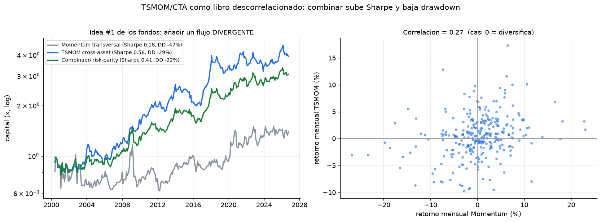

# Estrategias de fondos: qué aprendemos y qué aplicamos

Síntesis de la investigación sobre estrategias de hedge funds / fondos cuant y qué
es **aplicable** a nuestro sistema (solo OHLCV, Alpaca paper, instrumentos US).

## La lección de fondo (la más importante)

El error típico es buscar "la estrategia mágica de Renaissance". No existe para
nosotros: Medallion vive de microestructura, tick data y baja latencia. Lo que SÍ
es replicable es la **lección de los multi-manager** (Millennium, Citadel, Point72):
**no es una señal genial, son varias señales mediocres pero POCO CORRELACIONADAS,
con presupuesto de riesgo estricto y kill-switches.** Nuestra mayor palanca no es
subir el Sharpe de un libro, es **añadir 2‑3 flujos de retorno descorrelacionados**
y repartir riesgo entre ellos. La diversificación de flujos descorrelacionados es
el único "almuerzo gratis" real.

## Lo que SÍ podemos añadir (orden impacto/esfuerzo)

1. **TSMOM / CTA sobre cesta cross-asset de ETFs (+cripto).** Momentum de series
   temporales (cada activo largo/corto según su propio pasado, escalado por su vol),
   sobre ETFs de renta variable, bonos, oro y crédito. Flujo **divergente**
   ("crisis alpha"). **Validado abajo. Implementado: `patrones/tsmom.py`.**
2. **Libro market-neutral de pairs / stat-arb** (cointegración + Ornstein-Uhlenbeck,
   z-score de spreads). Su valor NO es su Sharpe (decaído), es su correlación ~0.
   Pares con lógica económica (mismo sector), no scan ciego.
3. **Módulo PEAD / drift post-earnings.** Tras una reacción grande + RVOL alto en
   día de resultados, entrar la sesión siguiente. Nativo a nuestra filosofía de
   catalizador. Necesita un feed de fechas de earnings (Yahoo/FMP gratis).
4. **Tilt de baja volatilidad / beta (BAB) en el libro diario.** Dentro del quintil
   líder de momentum, penalizar el decil de mayor vol/beta. Factor de PRECIO puro
   (no necesita fundamentales). Suaviza los *momentum crashes*.
5. **Presupuesto de riesgo entre libros (HRP) + kill-switches por libro.** El
   "sistema operativo" pod-shop: repartir riesgo entre libros con nuestro HRP, y
   apagar/reducir un libro que se degrada (stop de drawdown).
6. **Filtro de régimen por estructura temporal del VIX** (VIX/VIX3M): backwardation
   = estrés → reducir exposición. Uso honesto de la vol sin venderla.
7. **Ampliar features del meta-labeler** (residual momentum, breadth, régimen VIX),
   manteniendo el ML en rol secundario (sizing/filtrado), no como alfa primaria.

## Lo que descartamos (honestidad)

- **Market-making / HFT:** irreplicable sin order book L2, cola, rebates y baja
  latencia. No es esfuerzo, es infraestructura que no tendremos.
- **Venta de volatilidad / VRP:** cola izquierda catastrófica ("Sharpe alto hasta
  que te mata"). Viola la preservación de capital. (Sí usamos la *señal* de
  term-structure como régimen.)
- **Factores fundamentales (value/quality/QMJ, FF5):** necesitan fundamentales que
  OHLCV no da. Solo rescatable la parte de precio (low-vol/BAB).
- **Fábrica de alfa deep-learning / GBM primario:** trampa de sobreajuste y alpha
  decay; R² real diminuto. El ML correcto es el meta-labeler que ya tenemos.
- **All-Weather / risk parity apalancado global:** necesita apalancamiento e
  instrumentos que no montamos limpio en Alpaca. Ya tenemos HRP (mejor OOS).

## Validación de la idea #1 (TSMOM) — honesta

Backtest sobre cesta cross-asset (SPY, QQQ, IWM, DIA, TLT, GLD, HYG), 1990-2026,
con vol targeting de cartera al 12 %:

| | Sharpe | maxDD |
|---|---:|---:|
| Momentum transversal (libro diario, L/S) | 0.18 | −47 % |
| **TSMOM cross-asset** (libro nuevo) | 0.56 | −29 % |
| **Combinado risk-parity (61/39)** | **0.41** | **−22 %** |

- **Correlación TSMOM ↔ momentum = 0.27** (baja). Esa es la clave.
- TSMOM en solitario tiene un Sharpe **modesto** (0.56) — los CTA lo tienen; su
  valor es la **descorrelación**, no el heroísmo.
- Combinar los dos libros **más que duplica el Sharpe** del momentum (0.18 → 0.41)
  y **casi halves el drawdown** (−47 % → −22 %). Exactamente la tesis de los fondos.

**Honestidad:** TSMOM necesitaba *portfolio vol targeting* (sin él daba 30 % de vol
y −65 % de DD — sobre-apalancado); añadido. Sigue siendo un edge modesto y requiere
re-validarse (DSR/PBO) antes de operar en vivo. **No está cableado a la cartera
todavía** — es investigación validada, pendiente de tu visto bueno para montarlo
como "Libro C".

## Validación de una idea nueva (2-oct) — rotación por países europeos

Momentum transversal entre 10 ETFs de país europeos operables en Alpaca (EWG, EWQ,
EWP, EWU, EWI, EWN, EWL, EWD, EWO, EWK): largo el top-3 por momentum 6M con filtro
SMA200, a liquidez lo demás. Backtest 2010-2026 (detalle en `analisis_europa_2026-10.md`):

| | Rotación países | Mantener Europa (VGK) |
|---|---:|---:|
| Sharpe | **0.49** | 0.33 |
| Max drawdown | −30.8 % | −33.2 % |
| **Corr. con S&P 500** | **0.56** | 0.84 |

Bate a comprar-y-mantener Europa y, como el TSMOM, su valor es la **descorrelación**
(0.56 vs 0.84). **Candidato a Libro D**, pendiente de DSR/PBO antes de ir en vivo.
El motor (momentum transversal) ya existe en `patrones/transversal.py`.

## Infraestructura de datos (2-oct)

Auditado el stack de fuentes (ver `fuentes_datos.md`): **no hace falta nada de
pago**. Yahoo (ya cableado) da índices/acciones europeas, intradía europeo, EUR/USD
y **VIX + VIX3M** (desbloquea el filtro de régimen, idea #6, gratis). El único
límite real es de *ejecución* (Alpaca paper no llega a bolsas europeas; operamos vía
ADRs/ETFs US-listed) — una cuenta paper de Interactive Brokers lo resolvería, pero
no es necesaria hoy.

## Plan propuesto (cuando quieras)

1. **Ahora validado:** TSMOM (`patrones/tsmom.py`). → decidir si se monta como Libro C en vivo.
2. **Siguiente, barato y de alto impacto:** presupuesto de riesgo entre libros
   (HRP) + kill-switches (idea 5) y filtro VIX term-structure (idea 6).
3. **Medio plazo:** tilt low-vol en el diario (idea 4), módulo PEAD (idea 3,
   necesita feed de earnings), libro de pairs (idea 2, como diversificador).

Referencias clave: Moskowitz-Ooi-Pedersen (2012, TSMOM); AQR *Demystifying Managed
Futures*; López de Prado (HRP, meta-labeling, DSR/PBO — ya usados); Avellaneda-Lee
(2010, stat-arb); Bernard-Thomas (PEAD); Frazzini-Pedersen (2014, BAB);
Blitz-van Vliet (low-vol). Modelo pod-shop: Millennium/Citadel.
