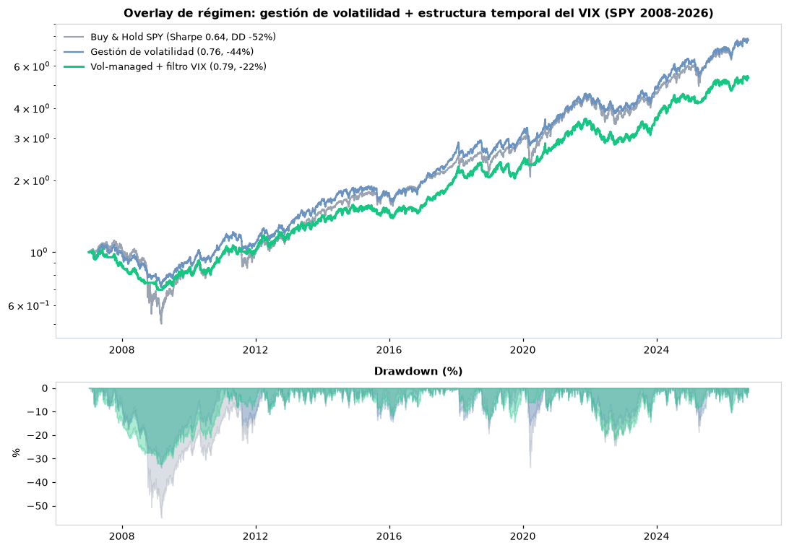

# Overlay de régimen: gestión de volatilidad + estructura temporal del VIX

Capa que **escala la exposición según el riesgo del mercado** — sube en calma, recorta
en estrés. Es de las mejoras más robustas y citadas de la literatura, y aquí sale
validada con honestidad.

## Los dos motores (validados sobre SPY)

**1. Gestión de volatilidad (Moreira-Muir 2017).** La exposición = `vol_objetivo /
vol_realizada reciente` (desfasada, sin mirar el futuro). Cuando la vol sube, se baja
exposición; cuando baja, se sube. Idea contraintuitiva pero muy robusta: la vol es
**persistente y predecible** (lo capta el GARCH), el retorno no.

**2. Filtro por estructura temporal del VIX.** `VIX / VIX3M`: por encima de 1
(**backwardation**) = estrés inminente → risk-off; por debajo (**contango**) = normal.
También risk-off si el VIX está muy alto (≥28). Usa la *señal* de la volatilidad sin
venderla (que sería ruinoso).

## Resultado (honesto, DSR 1.0)

| Estrategia | Sharpe | Vol | CAGR | Max drawdown |
|---|---:|---:|---:|---:|
| Comprar y mantener SPY | 0,65 | 18,5 % | 10,8 % | **−55 %** |
| Gestión de volatilidad (21d) | 0,76 | 14,5 % | 10,6 % | −44 % |
| Filtro VIX (desde 2008) | 0,78 | 14,1 % | 10,5 % | −31 % |
| **Combinado (vol-managed + VIX)** | **0,79** | 13,3 % | 10,1 % | **−22 %** |

- El combinado **más que reduce a la mitad el drawdown** (−55 % → −22 %) manteniendo
  casi el mismo retorno (CAGR ~10 %). Es el perfil que buscamos: **preservar capital**.
- **DSR 1.0**: la mejora de Sharpe es real, no suerte de haber probado variantes.
- No es "estar siempre fuera": la exposición media es ~1x; recorta solo cuando hay
  estrés (vol alta o backwardation).

Periodo: SPY 1993-2026 (vol-managed) y 2008-2026 (con VIX3M, que empieza ahí).

## Cómo está cableado (`patrones/regimen.py`)

- `multiplicador()` da un escalar de exposición en vivo = `vol_managed(SPY) × factor_VIX`.
  Hoy: VIX en contango y vol baja → ~1,3x (mercado tranquilo).
- **Aplicación conservadora en vivo**: en el dimensionado intradía (`gestionar.py`) se
  usa solo el lado PROTECTOR —`clip(mult, 0.3, 1.0)`—: en calma no apalanca (queda 1x),
  en estrés **reduce el tamaño de las nuevas posiciones**. El backtest valida también el
  lado de "inclinarse" en calma, pero en vivo somos prudentes.
- Visible en el terminal (panel **Régimen de mercado**: VIX, estructura, risk-on/off y
  exposición sugerida).

## Honestidad y límites

- El filtro VIX solo aplica desde 2008 (cuando existe el VIX3M). Antes, solo vol-managed.
- Es un overlay de MERCADO (SPY); se aplica como escalar global de exposición, no
  sustituye la selección de cada libro.
- Referencias: Moreira & Muir (2017, *Volatility-Managed Portfolios*, Journal of
  Finance); Harvey et al. (2018, *vol targeting*); estructura temporal del VIX como
  régimen (uso honesto de la señal, nunca vender vol).
